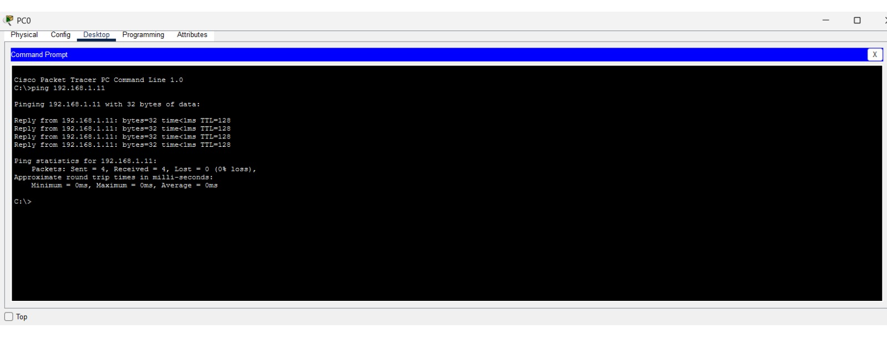

Laboratorio 1: Redes Seguras | UTP

Laboratorio académico de la Licenciatura en Ciberseguridad de la Universidad Tecnológica de Panamá, desarrollado por Josué Javier López Rangel.

Propósito
Practicar los fundamentos de redes de datos y seguridad: simular una red local, capturar tráfico y analizar los paquetes.

Topología

Verificación de conectividad

Herramientas
- Cisco Packet Tracer
- Wireshark
- Git y GitHub

Procedimiento
1. Diseñar la topología de red en Cisco Packet Tracer.
2. Configurar los dispositivos y verificar la conectividad.
3. Capturar el tráfico con Wireshark.
4. Analizar los paquetes y documentar los resultados.

Contacto
- GitHub: [josuelpz31](https://github.com/josuelpz31)
- Correo: josue.lopez2@utp.ac.pa

Licencia
Este proyecto usa la licencia MIT. Consulta el archivo [LICENSE](LICENSE).
